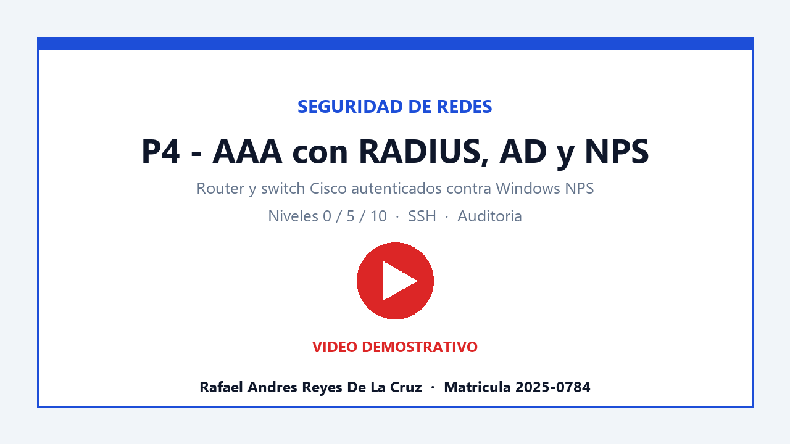
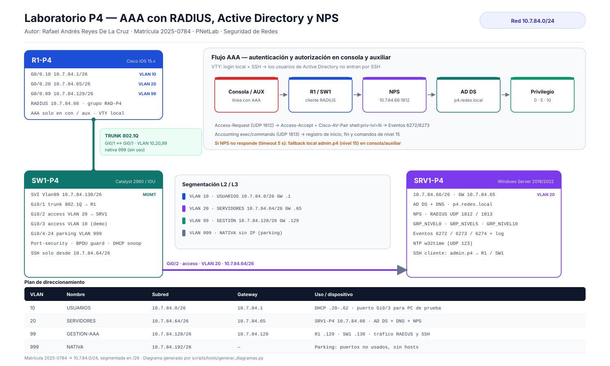

# P4 · Seguridad de Redes — AAA con RADIUS, Active Directory y NPS

**Rafael Andrés Reyes De La Cruz** · Matrícula **2025-0784** · Red **10.7.84.0/24** · Laboratorio **PNetLab**

> Autenticación, autorización y auditoría (AAA) centralizada en un router y un switch Cisco, con
> servidor Windows (AD DS + NPS) como servidor RADIUS y tres niveles de privilegio (0, 5 y 10).

---

## 🎥 1. Video demostrativo

> El video debe subirse a YouTube (máximo 10 minutos, fecha y hora
> visibles, rostro y voz del autor). Al publicarlo, reemplace `REEMPLAZAR_ID` en este bloque y en el
> archivo `RafaelAndresReyesDeLaCruz_20250784_P4.txt`.

[](https://youtu.be/REEMPLAZAR_ID)

**Guion y plan de grabación:** [`docs/09_Guion_Video.md`](docs/09_Guion_Video.md) · **Duración objetivo:** 9:30 min.

### Estado y evidencias reales

Las claves fueron sustituidas por `CAMBIAR_CLAVE` antes de publicar. Configure claves propias antes de ejecutar scripts o aplicar configuraciones.

- [Captura de la topología en PNetLab](evidencias/topologia-real.jpg) y [captura de políticas NPS](evidencias/nps-politicas-reales.png).
- Pruebas de consola del router: [nivel 5](evidencias/prueba-router-nivel5.txt) y [nivel 10](evidencias/prueba-router-nivel10.txt), con autenticación exitosa y `show privilege`.
- [Running-config real del router](configs/R1-P4_running-config.txt), con secretos redactados. El running-config del switch sigue siendo **de referencia**, no una captura real.
- El reloj del router no estaba sincronizado durante estas pruebas; sus fechas no son evidencia de la fecha real.
- La topología real utiliza C2691 `Fa0/0` y switch `Ethernet0/0`, con el servidor en `Ethernet0/1`. Las configuraciones de referencia y scripts pueden diferir de los equipos reales.

---

## 2. Propósito del laboratorio

Demostrar que la administración de la infraestructura de red puede delegarse de forma **controlada y
auditable**. El laboratorio implementa:

1. **AAA centralizado con RADIUS** (Windows NPS) para las líneas **de consola y auxiliar** del router y
   del switch: la identidad y el nivel de privilegio se resuelven contra Active Directory.
2. **Autorización por grupos**: `GRP_NIVEL0`, `GRP_NIVEL5` y `GRP_NIVEL10` se traducen en los niveles de
   privilegio 0, 5 y 10 del IOS mediante el atributo `shell:priv-lvl`.
3. **Acceso de emergencia local**: usuario local de privilegio 15, utilizado por SSH y como respaldo
   cuando el servidor RADIUS no responde (*fallback*).
4. **SSH como único protocolo de administración remota** (Telnet deshabilitado) y acceso restringido a
   la VLAN de gestión.
5. **Registro y auditoría** de autenticación, autorización y RADIUS en el dispositivo (syslog) y en el
   servidor (Eventos 6272/6273/6274 de NPS + log de contabilidad).

El detalle de objetivos, alcance y riesgos está en [`docs/01_Proposito_Alcance.md`](docs/01_Proposito_Alcance.md).

---

## 3. Topología



| Dispositivo | Rol | Plataforma sugerida | Dirección de gestión |
|---|---|---|---|
| **R1-P4** | Router *on-a-stick*, gateway de las VLAN, cliente RADIUS | Cisco IOS 15.x (c7200 / IOSv) | 10.7.84.129 (Vlan 99) |
| **SW1-P4** | Switch de acceso, SVI de gestión, cliente RADIUS | Cisco Catalyst 2960 / IOU L2 | 10.7.84.130 (Vlan 99) |
| **SRV1-P4** | AD DS + DNS + **NPS (RADIUS)** | Windows Server 2019/2022 | 10.7.84.66 (VLAN 20) |

Diagramas complementarios: [flujo AAA](diagrams/flujo_aaa.svg) · [niveles de privilegio](diagrams/niveles_privilegio.svg) · [fuentes Mermaid](diagrams/diagramas_mermaid.md).

---

## 4. Cumplimiento de requisitos

| Requisito de la tarea | Dónde se cumple | Evidencia |
|---|---|---|
| 1 router con seguridad AAA en todos los niveles | `configs/R1-P4_base.cfg` · [doc 04](docs/04_Configuracion_Router.md) | `images/02_r1_show_run_aaa.png` |
| 1 switch con seguridad AAA en todos los niveles | `configs/SW1-P4_base.cfg` · [doc 05](docs/05_Configuracion_Switch.md) | `images/03_sw1_show_run_aaa.png` |
| RADIUS configurado como cliente | Grupo `RAD-P4` → `10.7.84.66:1812/1813` | `images/15_show_aaa_servers.png` |
| Usuario local | `admin.p4` (privilegio 15) en ambos equipos | `images/07_consola_admin_fallback.png` |
| AAA **solo** en consola y auxiliar | `line con 0` / `line aux 0`; VTY usa `login local` | `show run \| section line` |
| Logs de autenticación, autorización y RADIUS | `aaa accounting`, `login on-*-log`, `logging buffered` | `images/16_show_logging.png` |
| Servicio SSH | `ip ssh version 2`, `transport input ssh` | `images/08_ssh_local_ok.png` |
| AD: grupos nivel 0, 5 y 10 | `GRP_NIVEL0/5/10` + [script AD](scripts/01_AD_Setup.ps1) | `images/17_ad_grupos.png` |
| Servicio NPS | Windows NPS con 3 políticas y VSA Cisco | `images/11_nps_politicas.png` |
| Documentación con imágenes y diagramas | `docs/` + `diagrams/` + `images/` | — |
| Scripts en el repositorio | `scripts/` | — |
| Running-configs en el repositorio | `configs/*_running-config.txt` | — |
| Video al inicio del repositorio | Sección 1 de este README | — |

---

## 5. Direccionamiento IP

La red se deriva de la matrícula **2025-0784**: `10.7.84.0/24`, segmentada en subredes `/26`.

| VLAN | Nombre | Subred | Gateway | Asignación |
|---:|---|---|---|---|
| 10 | USUARIOS | 10.7.84.0/26 | 10.7.84.1 | DHCP .20–.62 (reservado para clientes) |
| 20 | SERVIDORES | 10.7.84.64/26 | 10.7.84.65 | SRV1-P4 = **10.7.84.66** |
| 99 | GESTION / AAA | 10.7.84.128/26 | 10.7.84.129 | R1 = .129 · SW1 = .130 |
| 999 | NATIVA (parking) | 10.7.84.192/26 | — | Sin hosts, sin puerta de enlace |

Tabla completa, puertos y criterios de diseño: [`docs/03_Direccionamiento_IP.md`](docs/03_Direccionamiento_IP.md).

---

## 6. Estructura del repositorio

```text
P4-AAA-RADIUS-NPS/
├── README.md                     ← video al inicio + resumen
├── SECURITY.md                   ← nota sobre credenciales de laboratorio
├── RafaelAndresReyesDeLaCruz_20250784_P4.txt
├── docs/
│   ├── 01_Proposito_Alcance.md
│   ├── 02_Diseno_Topologia.md
│   ├── 03_Direccionamiento_IP.md
│   ├── 04_Configuracion_Router.md
│   ├── 05_Configuracion_Switch.md
│   ├── 06_Servidor_AD_NPS.md
│   ├── 07_Pruebas_Evidencias.md
│   ├── 08_Conclusiones.md
│   ├── 09_Guion_Video.md
│   ├── 10_Checklist_Entrega.md
│   ├── 11_Troubleshooting.md
│   └── 12_Referencias.md
├── configs/
│   ├── R1-P4_base.cfg
│   ├── SW1-P4_base.cfg
│   ├── R1-P4_running-config.txt
│   ├── SW1-P4_running-config.txt
│   ├── variantes/SW1-P4_IOU_L2.cfg
│   ├── legacy/radius-legacy.cfg
│   ├── opcional/command-authorization.cfg
│   └── nps/radius_clients.csv
├── scripts/
│   ├── 01_AD_Setup.ps1
│   ├── 02_NPS_Setup.ps1
│   ├── 03_Verificacion_AAA.ps1
│   └── tools/generar_imagenes.py
├── diagrams/
│   ├── topologia.svg
│   ├── flujo_aaa.svg
│   ├── niveles_privilegio.svg
│   └── diagramas_mermaid.md
├── images/                       ← capturas reales del laboratorio
└── evidencias/                   ← informes de verificación generados por script
```

---

## 7. Cómo reproducir el laboratorio

1. **Servidor**: crear la VM Windows Server, asignar `10.7.84.66/26` (GW `.65`, DNS `127.0.0.1`),
   promover el dominio `p4.redes.local` y ejecutar los scripts `01_AD_Setup.ps1` y `02_NPS_Setup.ps1`.
   Crear las tres políticas de NPS según [`docs/06_Servidor_AD_NPS.md`](docs/06_Servidor_AD_NPS.md).
2. **Router**: cargar `configs/R1-P4_base.cfg` y ejecutar `crypto key generate rsa modulus 2048`.
3. **Switch**: cargar `configs/SW1-P4_base.cfg` (o la variante IOU) y generar la clave RSA.
4. **Verificar**: aplicar la matriz de pruebas de [`docs/07_Pruebas_Evidencias.md`](docs/07_Pruebas_Evidencias.md).
5. **Evidencias**: guardar las capturas en `images/` con los nombres indicados y reemplazar los
   marcadores de posición.

**Credenciales de laboratorio** (solo para evaluación, rotar en producción):

| Usuario | Contraseña | Origen | Nivel | Uso |
|---|---|---|---|---|
| `usr.nivel0` | `CAMBIAR_CLAVE` | AD / RADIUS | 0 | Consola / auxiliar |
| `usr.nivel5` | `CAMBIAR_CLAVE` | AD / RADIUS | 5 | Consola / auxiliar |
| `usr.nivel10` | `CAMBIAR_CLAVE` | AD / RADIUS | 10 | Consola / auxiliar |
| `admin.p4` | `CAMBIAR_CLAVE` | Local | 15 | SSH y respaldo con NPS caído |

Secreto RADIUS compartido: `CAMBIAR_CLAVE`.

---

## 8. Resultados esperados

- La consola del router y del switch autentica contra NPS y **asigna el privilegio** del grupo AD.
- Los usuarios RADIUS **no pueden** entrar por SSH (VTY usa base local), y Telnet está deshabilitado.
- Si NPS no responde, la consola cae al usuario local de privilegio 15 (continuidad operativa).
- Cada intento exitoso o fallido queda registrado en el dispositivo y en el servidor.

Detalle de las 14 pruebas y sus resultados: [`docs/07_Pruebas_Evidencias.md`](docs/07_Pruebas_Evidencias.md).

---

## 9. Integridad académica

Trabajo **individual**. Las configuraciones y la documentación describen el laboratorio construido y
verificado por el autor; las capturas de `images/` deben corresponder a ese mismo laboratorio. Las
credenciales publicadas son de laboratorio y no protegen información real. Ver
[`docs/10_Checklist_Entrega.md`](docs/10_Checklist_Entrega.md).
