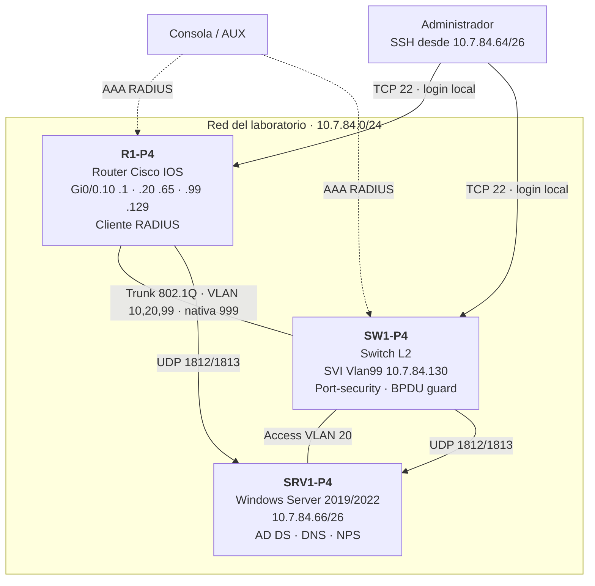
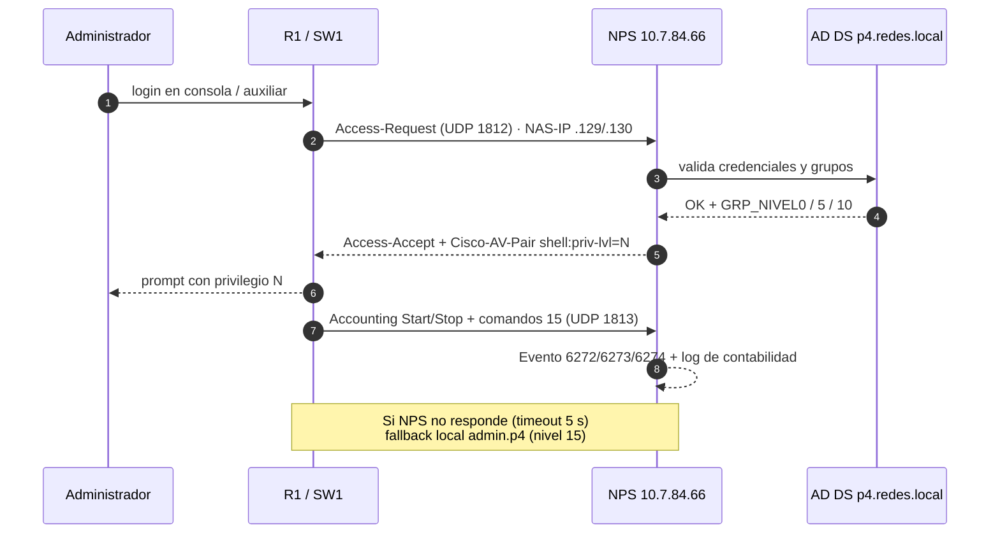
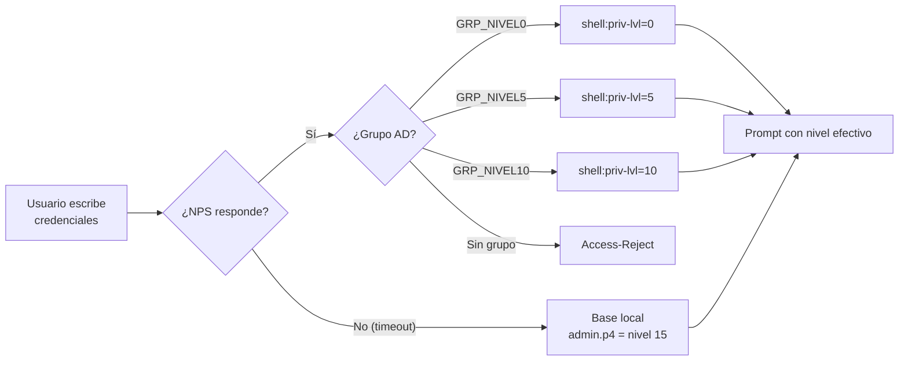

# Diagramas Mermaid

GitHub renderiza estos diagramas directamente. Las versiones SVG están en `diagrams/*.svg` y se usan
en el README y en la documentación.

## 1. Topología

## 2. Secuencia AAA

## 3. Decisión de autorización

