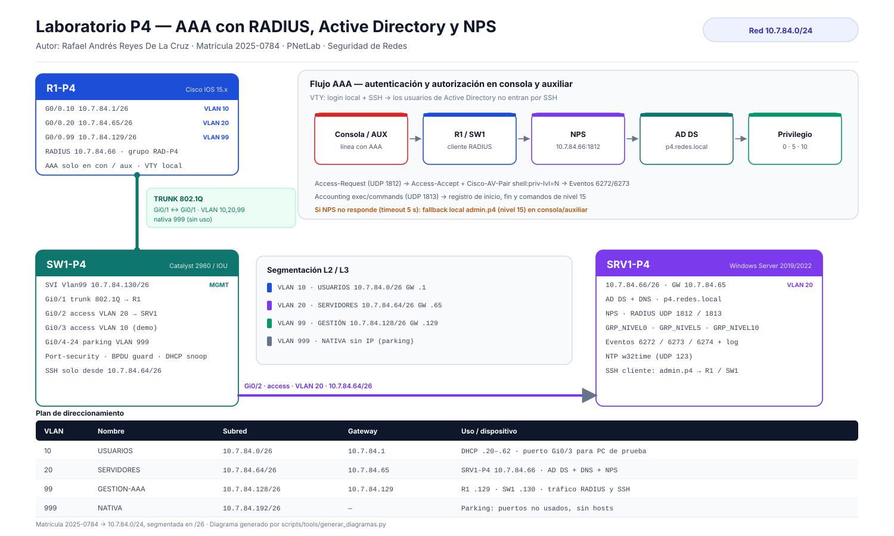
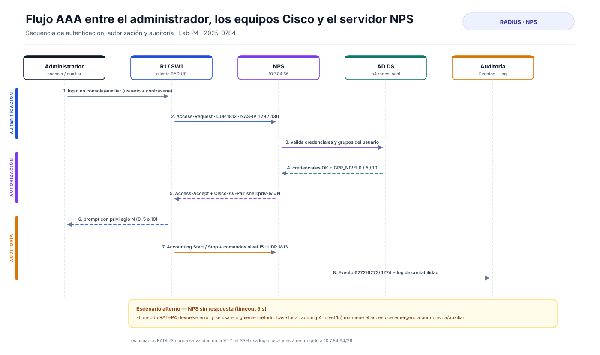
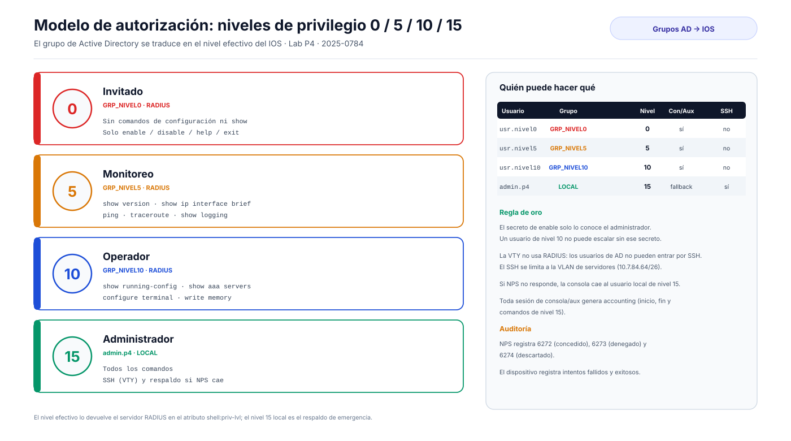

# 02 · Diseño de la topología

## 1. Vista general

La topología es una **red de tres dispositivos** con un router *router-on-a-stick* que interconecta tres
VLAN funcionales y un switch de acceso que concentra al servidor y a los puertos de usuario.

| Dispositivo | Modelo / imagen sugerida | Función principal |
|---|---|---|
| **R1-P4** | Cisco IOS 15.x (c7200 o IOSv) | Gateway de las VLAN, DHCP de usuarios, cliente RADIUS |
| **SW1-P4** | Catalyst 2960 o IOU/IOL L2 | Acceso L2, SVI de gestión, cliente RADIUS |
| **SRV1-P4** | Windows Server 2019/2022 | AD DS, DNS, **NPS (RADIUS)**, NTP, cliente SSH |

Enlaces:

| Enlace | Extremos | Tipo | VLANs |
|---|---|---|---|
| Trunk | R1 `Gi0/0` ↔ SW1 `Gi0/1` | 802.1Q | 10, 20, 99 (nativa 999) |
| Acceso servidor | SW1 `Gi0/2` ↔ SRV1 NIC | Access | 20 |
| Acceso demo | SW1 `Gi0/3` ↔ PC/VPC opcional | Access | 10 |

## 2. Por qué esta arquitectura

### 2.1 Router *on-a-stick* con subinterfaces

Permite separar usuarios, servidores y gestión **sin agregar hardware**. Cada VLAN tiene su propia
subred /26, su puerta de enlace y su política de acceso. El router es el único punto de enrutamiento
inter-VLAN, lo que simplifica la aplicación de ACLs.

### 2.2 NPS en el controlador de dominio

NPS necesita leer la pertenencia a grupos de AD. Colocarlo en el mismo servidor que el DC:

- elimina dependencias de red entre NPS y AD;
- simplifica el laboratorio (un solo servidor);
- mantiene el flujo RADIUS en la VLAN 20.

En producción se recomienda separar roles y desplegar al menos dos servidores NPS.

### 2.3 Consola/auxiliar con RADIUS y VTY local

La tarea exige AAA **solo** en consola y auxiliar. Por eso:

- `line con 0` y `line aux 0` usan la lista `CON-RADIUS` (RADIUS → local);
- `line vty 0 4` usa `login local` y solo acepta SSH.

Consecuencia de diseño: **los usuarios de AD no pueden entrar por SSH**, y el acceso remoto queda
reservado al usuario local `admin.p4`, restringido por ACL a la VLAN de servidores. Esto cumple el
requisito y reduce la superficie de ataque.

### 2.4 Doble vía de autenticación

| Vía | Método | Uso |
|---|---|---|
| Consola / auxiliar | RADIUS (NPS) con *fallback* local | Operación diaria y auditoría por usuario |
| SSH (VTY) | Base local | Administración remota desde la VLAN de servidores |
| Emergencia | `admin.p4` local | NPS caído o pérdida de conectividad |

El *fallback* solo se activa cuando el servidor **no responde** (timeout). Si NPS responde con un
rechazo, el acceso se deniega: es el comportamiento correcto de seguridad.

## 3. Flujo AAA

1. El administrador se conecta a la consola o al auxiliar y escribe usuario y contraseña.
2. El equipo envía un `Access-Request` a `10.7.84.66:1812` con `NAS-IP-Address` = `10.7.84.129`
   (router) o `10.7.84.130` (switch).
3. NPS valida las credenciales contra AD y resuelve la pertenencia a `GRP_NIVEL0/5/10`.
4. NPS responde `Access-Accept` con el atributo de fabricante `Cisco-AV-Pair = shell:priv-lvl=N`.
5. IOS aplica el nivel y muestra el prompt correspondiente.
6. El equipo envía contabilidad (`Accounting-Request` Start/Stop y comandos de nivel 15) a
   `10.7.84.66:1813`.
7. NPS escribe el evento 6272/6273/6274 y el registro de contabilidad.

## 4. Niveles de privilegio

| Nivel | Grupo AD | Alcance |
|---:|---|---|
| 0 | `GRP_NIVEL0` | Sin comandos de diagnóstico ni configuración |
| 5 | `GRP_NIVEL5` | `show`, `ping`, `traceroute`, `show logging` |
| 10 | `GRP_NIVEL10` | Añade `show running-config` y `configure terminal` |
| 15 | `admin.p4` (local) | Control total, SSH y emergencia |

> El nivel 15 **no** se entrega por RADIUS: se reserva al usuario local. Así, un compromiso de NPS no
> concede automáticamente privilegio total.

## 5. Segmentación y endurecimiento

| Medida | Dónde | Propósito |
|---|---|---|
| VLAN 999 nativa sin hosts | Trunk | Evita *VLAN hopping* por la VLAN nativa |
| `switchport nonegotiate` | Trunk y accesos | Deshabilita DTP |
| `switchport trunk allowed vlan 10,20,99` | Trunk | Minimiza VLANs transportadas |
| Port-security *sticky* | Gi0/2 y Gi0/3 | Limita MAC por puerto |
| BPDU guard + PortFast | Puertos de acceso | Evita bucles y switches no autorizados |
| DHCP snooping | VLAN 10, trunk confiable | Bloquea servidores DHCP falsos |
| Puertos 4–24 en VLAN 999 y `shutdown` | Switch | Reduce superficie física |
| ACL de usuarios → gestión | R1 `Gi0/0.10` | Aísla la VLAN 99 |
| `access-class SSH-ADMIN` | VTY de ambos equipos | Solo SSH desde 10.7.84.64/26 |
| `exec-timeout` | con/aux/vty | Cierra sesiones inactivas |
| Banner + logs | Ambos | Advertencia legal y trazabilidad |

## 6. Direccionamiento de las interfaces

| Equipo | Interfaz | Dirección | VLAN |
|---|---|---|---|
| R1-P4 | `Gi0/0.10` | 10.7.84.1/26 | 10 |
| R1-P4 | `Gi0/0.20` | 10.7.84.65/26 | 20 |
| R1-P4 | `Gi0/0.99` | 10.7.84.129/26 | 99 |
| R1-P4 | `Gi0/0.999` | sin IP (nativa) | 999 |
| SW1-P4 | `Vlan99` | 10.7.84.130/26 | 99 |
| SW1-P4 | `Vlan1` | apagada | — |
| SRV1-P4 | NIC | 10.7.84.66/26 | 20 |

## 7. Adaptación a PNetLab

Las imágenes no son intercambiables: los nombres de interfaz cambian.

| Imagen | Interfaz del trunk | Interfaz del servidor | Observación |
|---|---|---|---|
| c7200 / IOSv | `Gi0/0` (subinterfaces) | — | Usar `configs/R1-P4_base.cfg` |
| Catalyst 2960 | `Gi0/1` | `Gi0/2` | Usar `configs/SW1-P4_base.cfg` |
| IOU/IOL L2 | `Et0/0` | `Et0/1` | Usar `configs/variantes/SW1-P4_IOU_L2.cfg` |

Si el switch es IOU/IOL, **no existe puerto auxiliar**: el requisito se cumple sobre `line con 0` y se
documenta la limitación en [05 · Configuración del switch](05_Configuracion_Switch.md).

## 8. Limitaciones del diseño

- Un solo servidor NPS: si cae, se pierde la autenticación centralizada (queda el *fallback* local).
- El nivel 15 local es un punto único de escalada si se conoce el `enable secret`.
- No hay 802.1X: el control de acceso físico depende de port-security y del cierre de puertos.
- El tráfico RADIUS viaja sin TLS dentro de la VLAN 99; en producción se recomienda RadSec o IPsec.

---

**Anterior:** [01 · Propósito](01_Proposito_Alcance.md) · **Siguiente:** [03 · Direccionamiento IP](03_Direccionamiento_IP.md)
