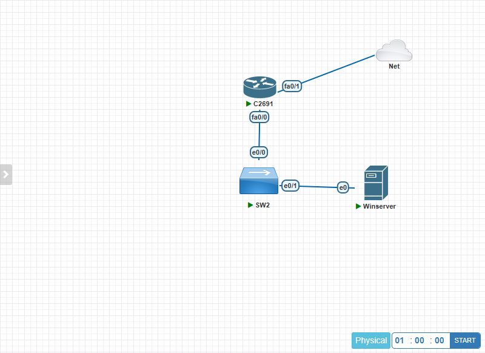

# 03 · Direccionamiento IP y plan de VLANs

## 1. Derivación desde la matrícula

| Dato | Valor |
|---|---|
| Matrícula | 2025-0784 |
| Red asignada | **10.7.84.0/24** |
| Criterio | `10.<7>.<84>.0/24` a partir de los dígitos 7 y 84 de la matrícula |
| Máscara base | /24 (256 direcciones) |
| Segmentación | 4 subredes /26 (64 direcciones cada una) |

Cálculo de la máscara /26:

```text
/26  →  2^(32-26) = 64 direcciones por subred
       64 - 2 (red y broadcast) = 62 hosts útiles
       255.255.255.192
       bloques: 0, 64, 128, 192
```

## 2. Plan de direccionamiento

| VLAN | Nombre | Subred | Rango útil | Broadcast | Gateway |
|---:|---|---|---|---|---|
| 10 | USUARIOS | 10.7.84.0/26 | .1 – .62 | .63 | 10.7.84.1 |
| 20 | SERVIDORES | 10.7.84.64/26 | .65 – .126 | .127 | 10.7.84.65 |
| 99 | GESTION-AAA | 10.7.84.128/26 | .129 – .190 | .191 | 10.7.84.129 |
| 999 | NATIVA (parking) | 10.7.84.192/26 | .193 – .254 | .255 | — (sin hosts) |

### Asignaciones fijas

| IP | Equipo | VLAN | Observación |
|---|---|---|---|
| 10.7.84.1 | R1-P4 `Gi0/0.10` | 10 | Gateway de usuarios |
| 10.7.84.20–.62 | Clientes DHCP | 10 | Rango dinámico (`ip dhcp pool`) |
| 10.7.84.65 | R1-P4 `Gi0/0.20` | 20 | Gateway de servidores |
| **10.7.84.66** | **SRV1-P4** | 20 | AD DS + DNS + NPS |
| 10.7.84.129 | R1-P4 `Gi0/0.99` | 99 | Gateway y **origen RADIUS** del router |
| 10.7.84.130 | SW1-P4 `Vlan99` | 99 | Gestión y **origen RADIUS** del switch |
| 10.7.84.192/26 | — | 999 | Parking, sin direccionamiento |

## 3. Mapa de puertos del switch

| Puerto | Modo | VLAN | Descripción | Seguridad |
|---|---|---|---|---|
| `Gi0/1` | Trunk | 10, 20, 99 (nativa 999) | Hacia R1 | `nonegotiate`, DHCP snooping *trust* |
| `Gi0/2` | Access | 20 | SRV1-P4 | Port-security 1 MAC *sticky*, BPDU guard |
| `Gi0/3` | Access | 10 | PC/VPC de prueba | Port-security 1 MAC *sticky*, BPDU guard |
| `Gi0/4–24` | Access | 999 | No usados | `shutdown` |

## 4. Servicios de red

### DHCP (solo VLAN 10)

```text
ip dhcp excluded-address 10.7.84.1 10.7.84.19
ip dhcp pool VLAN10-USUARIOS
 network 10.7.84.0 255.255.255.192
 default-router 10.7.84.1
 dns-server 10.7.84.66
 domain-name p4.redes.local
 lease 0 8
```

El servidor y la VLAN de gestión usan direccionamiento **estático**: no deben depender de DHCP para
la autenticación.

### DNS

`SRV1-P4` (10.7.84.66) resuelve `p4.redes.local`. El router y el switch usan `ip domain name
p4.redes.local` para generar la clave RSA y el nombre del host.

### RADIUS

| Atributo | Router | Switch |
|---|---|---|
| Servidor | 10.7.84.66 | 10.7.84.66 |
| Auth / Acct | UDP 1812 / 1813 | UDP 1812 / 1813 |
| Origen (`ip radius source-interface`) | `Gi0/0.99` → .129 | `Vlan99` → .130 |
| Grupo | `RAD-P4` | `RAD-P4` |

Ambas direcciones deben existir como **clientes RADIUS** en NPS. Si el origen cambia, NPS descarta la
petición y el login falla aunque las credenciales sean correctas.

### NTP

| Equipo | Servidor | Nota |
|---|---|---|
| SRV1-P4 | w32time como servidor NTP | `AnnounceFlags=5`, UDP 123 |
| R1-P4 / SW1-P4 | `ntp server 10.7.84.66` | Si no sincroniza, usar `clock set` |

La hora correcta es imprescindible para correlacionar los eventos 6272/6273 con las capturas del video.

## 5. Flujo entre subredes

| Origen | Destino | Puerto | Permitido |
|---|---|---|---|
| VLAN 10 (usuarios) | VLAN 20 (servidores) | DNS 53, Kerberos 88, LDAP 389, SMB 445… | Sí (ACL permite el resto) |
| VLAN 10 (usuarios) | VLAN 99 (gestión) | cualquiera | **No** (`ACL-USUARIOS-IN`) |
| VLAN 99 (R1/SW1) | SRV1 `10.7.84.66` | UDP 1812/1813 | Sí |
| VLAN 20 (SRV1) | R1 `10.7.84.129` / SW1 `.130` | TCP 22 | Sí (`SSH-ADMIN`) |
| Cualquier otra | VTY de R1/SW1 | TCP 22 | **No** (`access-class`) |

## 6. Verificación del direccionamiento

```text
! Router
show ip interface brief
show ip route
show ip dhcp binding

! Switch
show vlan brief
show interfaces trunk
show interfaces status
show ip interface brief

! Servidor
ipconfig /all
ping 10.7.84.129
ping 10.7.84.130
```

Resultados esperados (extracto):

```text
R1-P4# show ip interface brief
Interface              IP-Address      OK? Method Status                Protocol
GigabitEthernet0/0     unassigned      YES manual up                    up
GigabitEthernet0/0.10  10.7.84.1       YES manual up                    up
GigabitEthernet0/0.20  10.7.84.65      YES manual up                    up
GigabitEthernet0/0.99  10.7.84.129     YES manual up                    up

SW1-P4# show vlan brief
VLAN Name                             Status    Ports
---- -------------------------------- --------- -------------------------------
10   USUARIOS                         active    Gi0/3
20   SERVIDORES                       active    Gi0/2
99   GESTION-AAA                      active
999  NATIVA-PARKING                   active    Gi0/4, Gi0/5, ...
```



---

**Anterior:** [02 · Diseño](02_Diseno_Topologia.md) · **Siguiente:** [04 · Router](04_Configuracion_Router.md)
